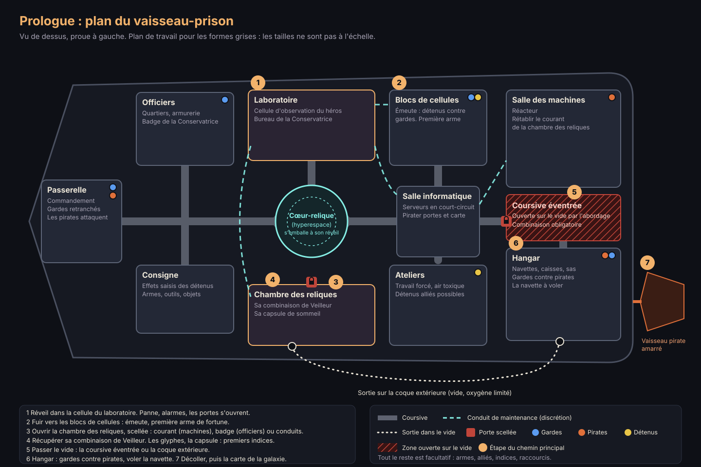

# Échos d'Éther : dossier de préproduction (refonte)

> Version 3, 28 octobre 2026. Remplace `GDD.md`, gardé pour mémoire.
> Budget : **0 €**, seulement des assets et des outils gratuits utilisables dans un jeu vendu.
> Statut : **proposition à valider** (voir [Décisions à prendre](#decisions)).

## 1. Ce qui change

Le jeu repart de zéro. Il commence désormais par une évasion :

1. Le joueur se réveille **prisonnier, amnésique**, dans **un vaisseau-prison ennemi, dans l'espace**. Il ne sait ni qui il est, ni pourquoi il est là.
2. **Des pirates attaquent** le vaisseau. Les ordinateurs disjonctent et **les cellules s'ouvrent**.
3. En tenue de prisonnier, il doit **récupérer un équipement** pour atteindre le hangar, puis il **s'échappe** à travers un vaisseau immense, avec plusieurs chemins plutôt qu'un couloir imposé.
4. Il **vole une navette** et passe en **hyperespace**.
5. Ensuite, **la galaxie est ouverte** : il va où il veut, dans l'ordre qu'il veut. **Sa quête : retrouver la mémoire**, savoir qui il est et pourquoi tout cela lui arrive.

**Mélange de références :**

| Référence | Ce qu'on lui emprunte |
|---|---|
| *Star Wars* | Matériel usé, base impériale, vol de vaisseau, saut spatial, hors-la-loi |
| *Dune* | Désert immense et hostile, soleil, bruit qui attire le danger, ver |
| *Helldivers* | Gameplay : tir à la 3e personne lourd et réaliste, chaos, appels de soutien, tir allié en coop |

**Style visuel : réaliste** (Unity 6 HDRP).

Comme avant, on emprunte des sensations, jamais des noms, des logos ou des designs protégés.

## 2. Ce que font les pros (synthèse des lectures)

### Préproduction et tranche verticale
- **La préproduction a une durée limitée.** Sinon, on l'itère sans fin. On y fait plusieurs prototypes de gameplay avant de s'engager.
- **Le prototype** répond à la question « est-ce amusant ? », avec des formes grises et sans graphismes.
- **La tranche verticale** répond à « sait-on le fabriquer ? ». C'est un petit morceau du jeu au niveau de qualité final : gameplay, graphismes, son, interface.
  - Elle sert de test pour sortir de la préproduction (talk GDC de Volition).
  - Règle courante : **couper du contenu avant de couper de la qualité.**
- **Documents courts** : Stone Librande (GDC) défend les **designs d'une page**, parce que presque personne ne lit au-delà de la première page.
  - 2 à 4 **piliers** servent de juge pour chaque décision.

### Monde ouvert pour une petite équipe
- Les témoignages de développeurs seuls disent la même chose : **le monde ouvert est le premier piège de scope.**
- Les solutions qui reviennent :
  - construire le monde avec des **blocs modulaires** réutilisables ;
  - rendre **un verbe** excellent (se déplacer, se cacher) avant d'ajouter du contenu ;
  - définir précisément ce que veut dire « ouvert » pour son propre jeu.
- **Chemin critique et liberté** :
  - de grandes zones d'exploration, avec un chemin principal plus étroit ;
  - des **repères visuels** visibles de loin (tours, antennes) ;
  - des barrières douces (relief, falaises) plutôt que des murs invisibles.

### Les ouvertures qui servent de modèle
| Jeu | Ce qu'on retient |
|---|---|
| *Zelda : Breath of the Wild*, le Plateau du Prélude | Une **zone ouverte fermée sur elle-même**, qui apprend tous les systèmes. On la quitte quand on a l'outil pour partir (la paravoile). Pour nous, **la navette joue ce rôle**. Les critiques la classent parmi les meilleurs didacticiels. |
| *Metal Gear Solid V : Ground Zeroes*, le camp Omega | **Une base ouverte**, découpée en secteurs, avec plusieurs routes. La discrétion et le combat sont deux options valables. Le terrain est limité, la partie courte, et on la rejoue souvent. |
| *Skyrim*, Helgen | **Prologue d'évasion** : un événement dramatique (le dragon) libère le prisonnier. Les enjeux sont posés tout de suite. Selon un ancien designer, environ 30 % des joueurs sont partis explorer au lieu de suivre la route : la liberté marche. |
| *No Man's Sky* | Le premier objectif est de **remettre un vaisseau en état pour quitter la planète**. Ce qui gêne les joueurs : rester bloqué sans ressources. Il faut toujours une solution de secours. |
| *Star Wars Outlaws* | Le passage du sol à l'espace a l'air continu. Les sauts relient orbite et orbite, et de **courtes cinématiques cachent les chargements**. Exactement ce qu'il nous faut pour le saut final. |
| *Dune : Awakening* | Les vers sont attirés par le mouvement sur le sable, avec une **jauge de vibration** à l'écran. C'est l'élément le plus salué par les critiques. |
| *Helldivers 2* | Le studio met la **crédibilité** avant tout : le tir allié en découle et force à réfléchir en combat. Le chaos émerge des systèmes, pas des scripts. |

## 3. Proposition de jeu

### Les 4 piliers
1. **S'en sortir** : chaque minute est une évasion, et on survit avec ce qu'on trouve.
2. **Crédible et lourd** : le réalisme des armes, du corps et des machines, à la manière d'Helldivers.
3. **Plusieurs chemins** : discrétion, assaut, diversion. Le monde réagit au bruit, comme dans Dune.
4. **Le milieu est un ennemi** : le vide et le silence de l'espace dans le prologue, puis le désert, sa chaleur et ce qui dort sous le sable.

### Le prologue : l'évasion du vaisseau-prison (première tranche verticale)
- **Durée** : 30 à 45 minutes la première fois.
- **Lieu** : un vaisseau-prison ennemi, immense, en orbite. Il est découpé en secteurs : bloc des cellules, ateliers où travaillent les prisonniers, salle des machines, quartiers des gardes, passerelle, hangar.
- **Plusieurs chemins** entre les secteurs : coursives, conduits de maintenance, et **la coque extérieure, dans le vide**.
- **Mêmes règles que le reste du jeu** : c'est le Plateau du Prélude de notre jeu, version spatiale.
- Références d'ambiance :
  - l'évasion de la prison de l'Étoile de la Mort dans *Star Wars*, où il faut couper le rayon tracteur pour pouvoir fuir ;
  - la station ouverte et les sorties dans le vide de *Prey* (2017) ;
  - l'apesanteur et la décompression de *Dead Space*.

**Trois camps dans le vaisseau**, ce qui crée le chaos systémique à la Helldivers :
- **les gardes** tentent de reprendre le contrôle ;
- **les pirates** abordent et pillent ;
- **les prisonniers** : certains sont hostiles, d'autres peuvent devenir des alliés de fortune.

Les trois camps se battent aussi entre eux. Le joueur peut s'en servir : attirer les pirates sur les gardes, passer pendant qu'ils s'affrontent.

| Étape | Ce qui se passe | Ce que le joueur apprend |
|---|---|---|
| 1. Le réveil | Le joueur se réveille dans une cellule d'observation du **laboratoire** du vaisseau-prison, sans souvenirs. Un flash flou : une capsule qui s'ouvre, des lampes de chercheurs. Puis les secousses de l'abordage, les alarmes, la lumière qui saute. | Regarder, se déplacer |
| 2. Les cellules s'ouvrent | Les ordinateurs disjonctent, toutes les portes s'ouvrent, c'est la ruée. Le cœur d'hyperespace (une relique des Bâtisseurs) s'emballe en même temps : le joueur ne sait pas encore que c'est à cause de lui. En tenue de prisonnier, sans arme, il est faible : il se cache et improvise. | S'accroupir, se cacher, le bruit, ramasser une arme de fortune |
| 3. Récupérer l'équipement | Le hangar est coupé du reste par des sections éventrées par les pirates, donc ouvertes sur le vide. Il faut **une combinaison**, rangée dans la **chambre des reliques** du laboratoire. **C'est la sienne : une combinaison de Veilleur des Bâtisseurs**, couverte de glyphes qu'il lit sans comprendre pourquoi. Sa capsule de sommeil est là, elle aussi. | Chemins multiples, discrétion ou combat, piratage de portes |
| 4. Le vide | Avec la combinaison, il traverse les sections ouvertes et **la coque extérieure** : bottes magnétiques, apesanteur, oxygène limité, et le silence total du vide (on n'entend que sa respiration et ce qui passe par la coque). | Sortie dans l'espace, gestion de l'air, nouvelles règles du bruit |
| 5. Le hangar | Seule sortie vers les navettes : les pirates y ont amarré leur vaisseau et les gardes s'y retranchent. **Pas de compte à rebours** : le joueur prend le temps de choisir comment passer. Combat entre gardes et pirates, sas qu'on peut ouvrir sur le vide pour aspirer les ennemis. Il faut démarrer une navette. | Combat sous pression, se servir du décor |
| 6. L'hyperespace | Fuite sous le feu des tourelles, puis le passage en hyperespace : la navette atteint la vitesse de la lumière, les étoiles s'étirent en traits. Ce voyage cache le chargement, avant l'écran-titre. | Récompense émotionnelle |

**Le plan du niveau** : [`prologue/plan-vaisseau-prison.svg`](prologue/plan-vaisseau-prison.svg) (sections, coursives, conduits, sorties dans le vide, camps).

**Zones facultatives** dans le vaisseau : une arme meilleure, des prisonniers à libérer, et surtout **des indices sur son identité**. Le joueur curieux en apprend plus que celui qui fonce.

**Règle de secours** (la leçon de No Man's Sky) : chaque étape a au moins deux façons d'être réussie. On ne bloque jamais le joueur.

**Le saut ouvre la suite.** Après l'évasion, la carte de la galaxie s'ouvre et **le joueur choisit lui-même où aller**. Chaque destination peut servir de point de départ.
La navette volée devient le refuge du joueur et lui donne plus tard ses appels de soutien.
Pendant le prologue, il est seul et sans soutien. C'est voulu : il n'a encore rien.
En coop, les 4 joueurs seront des **codétenus** qui s'évadent ensemble.

### L'histoire : retrouver la mémoire
- **Le joueur en sait autant que son personnage** : rien. Ils découvrent la vérité ensemble. C'est ce qui fait marcher les histoires d'amnésie.
- **Les souvenirs se retrouvent dans le monde ouvert** : lieux, objets, personnes qui le reconnaissent. Chacun débloque un fragment de souvenir, en flash jouable ou en courte scène, et une **carte des souvenirs** les relie.
  - On retrouve l'idée de l'ancien GDD : la progression, c'est la connaissance.
- **L'amnésie est un thème très utilisé** (dont un célèbre retournement de situation dans un jeu Star Wars). Pour rester original :
  - la vérité doit être **la nôtre** ;
  - les indices doivent être **justes** : le joueur attentif peut la deviner avant la fin.
- **Règle de pro** : on fixe toute la vérité **avant** d'écrire le reste (qui il est, pourquoi il est en prison, qui le cherche), même si le joueur ne l'apprend qu'à la fin. Chaque indice en découle.
- Le titre *Échos d'Éther* colle bien : les souvenirs perdus sont des **échos**.

### L'histoire retenue : l'Ancien

Décidée le 28 octobre 2026 : c'est la version **B** développée plus bas. Le reste de ce chapitre garde les autres pistes pour mémoire.

**La vérité** (secrète : le joueur ne la découvre qu'à la fin)
- Il y a des milliers d'années, les **Bâtisseurs** maîtrisaient l'Éther, le temps figé. Ils ont couvert la galaxie de ruines et de relais d'hyperespace.
- Une menace qui dévore le temps, le **Chœur du Tombeau**, les a poussés à fuir. Ils se sont réfugiés **dans l'Éther**. Les cristaux que l'empire récolte et brûle, ce sont eux.
- Le héros est un **Veilleur** : endormi dans une capsule, chargé de se réveiller quand la menace reviendrait. La récolte de l'Éther, qui affaiblit les Bâtisseurs et rapproche la menace, l'a réveillé à moitié. L'empire a trouvé sa capsule et l'étudie dans le laboratoire du vaisseau-prison.
- Son amnésie vient du sommeil et des expériences de l'empire. Ses souvenirs dorment dans les archives des ruines.

**Une galaxie ouverte, une histoire en puzzle**

Après le prologue, le joueur se balade **où il veut dans la galaxie, dans l'ordre qu'il veut**. L'histoire n'est donc pas une suite de chapitres : c'est un **puzzle**, comme dans *Outer Wilds*. Les souvenirs et les indices sont éparpillés sur tous les mondes, et chaque joueur les trouve dans un ordre différent.

| Pièces du puzzle | Où on les trouve |
|---|---|
| Il n'est pas normal (scanner, glyphes, relique qui s'emballe, sa capsule) | Le prologue, pour tout le monde |
| Les Bâtisseurs ont existé, et leurs ruines s'ouvrent pour lui | N'importe quelle ruine, sur n'importe quel monde |
| L'empire sait ce qu'il est (« Tu es l'un d'eux ») | Les messages de la Conservatrice, qui le traque partout |
| Son rôle de Veilleur, la menace, la mission des machines anciennes | Les archives des ruines et les échos jouables, sur plusieurs mondes |
| La récolte de l'Éther rapproche la menace | Les sites d'extraction de l'empire, les pirates, les échos |
| La vérité sur l'Éther, et le choix final | Le Cœur de l'Écho |

**Ce qui guide le joueur sans l'enfermer**
- **On progresse par le savoir, pas par les objets.** Le Cœur de l'Écho n'est pas fermé à clé : il est **caché**. On ne peut le trouver qu'en ayant assez compris (des coordonnées reconstituées, des glyphes déchiffrés). Comme dans *Outer Wilds*, un joueur qui sait peut y aller très tôt.
- **Une carte des souvenirs** relie les pièces trouvées et montre les pistes ouvertes. Le joueur voit ce qu'il ne comprend pas encore et choisit quelle piste suivre.
- **Le danger varie selon les régions** : zones contrôlées par l'empire, territoires pirates, mondes sauvages. On peut aller partout, mais pas partout sans risque.
- **Le voyage a un prix.** Les vaisseaux de l'empire passent en hyperespace en brûlant de l'Éther. Au début, le joueur aussi. Plus tard, il découvre qu'il brûle son propre peuple, et qu'il peut voyager autrement : par les relais des Bâtisseurs, qu'il réveille un à un. Le gameplay rejoint l'histoire.

### Un univers sans fin, comme *No Man's Sky*

Décidé le 28 octobre 2026 : le nombre de galaxies importe peu. Ce qui compte, c'est que **le joueur puisse traverser les mondes et parcourir l'univers sans s'arrêter** : marcher sur une planète, décoller, sortir de l'atmosphère, voler vers une autre planète, sauter vers un autre système.

**Comment on le fabrique** (les principes de *No Man's Sky*, présentés à la GDC 2017)
- **Tout naît d'une graine.** Chaque galaxie, système, planète et rocher est calculé à partir d'un nombre. Rien n'est stocké : le monde est recalculé quand le joueur s'approche, et il est toujours le même pour tout le monde.
- **La chaîne de génération** : relief, puis maillage, puis textures, puis peuplement (roches, plantes, animaux, ruines, bases), puis simulation. Tout se fait en continu, en arrière-plan, pendant que le joueur avance (Jobs et Burst dans Unity).
- **Des planètes rondes à niveaux de détail** : seul le terrain proche du joueur est détaillé. La maquette web avait déjà une planète de ce type, et le projet Unity a déjà une gravité sphérique.
- **Une origine flottante** : le monde se recentre en permanence autour du joueur, sinon les distances immenses font trembler l'image (limite de précision des nombres).
- **Du sol à l'espace sans écran de chargement** : on vole en continu de la surface à l'orbite. Entre deux systèmes, on passe en **hyperespace** : le vaisseau atteint la vitesse de la lumière, les étoiles s'étirent en traits, et ce voyage de quelques secondes cache le chargement du système d'arrivée (comme dans *Star Wars Outlaws*). Détails dans [`UNIVERS-TECHNIQUE.md`](UNIVERS-TECHNIQUE.md).
- **Peupler l'infini avec peu de moyens** : un nombre limité de pièces de qualité (rochers, plantes, bâtiments, textures Poly Haven et ambientCG), combinées et variées par la graine. Mieux vaut moins de types de biomes, mais beaux.

**L'histoire dans un univers infini**
- Les pièces importantes du puzzle sont dans des **mondes-clés** placés à des endroits fixes, faits à la main : une dizaine de systèmes, dont le Cœur de l'Écho, caché.
- Partout ailleurs, la génération sème des **ruines mineures** des Bâtisseurs, des sites d'extraction de l'empire et des épaves pirates. On y trouve des souvenirs secondaires et des ressources.
- Le joueur peut donc se perdre dans l'infini pour le plaisir, et revenir aux mondes-clés quand il veut avancer dans l'histoire.

**Prudence de pro** : *No Man's Sky* a été fait par une équipe pendant des années. Pour nous, c'est **le risque technique numéro un**. Il faut donc le prototyper très tôt, en même temps que le prologue, avant de construire le reste dessus.

**Tout l'ancien univers trouve sa place**
| Ancien GDD | Dans l'histoire de l'Ancien |
|---|---|
| L'Éther, un écho de temps figé | Le refuge des Bâtisseurs |
| La Concorde, empire propagandiste qui récolte l'Éther | L'empire qui brûle les Bâtisseurs pour voyager, sans le savoir (ou en le sachant, tout en haut) |
| La Ruche des Sables, « système immunitaire » qui protège les gisements | Des gardiens créés par les Bâtisseurs pour protéger leurs gisements, donc leurs âmes |
| La Légion Mécanique, anciens éclaireurs encore en mission | Les machines éclaireuses des Bâtisseurs |
| Le Chœur du Tombeau et le Lacérateur | La menace qui dévore le temps |
| Les six secteurs | Des mondes de ruines visités dans l'ordre que le joueur veut. Le Cœur de l'Écho, là où dorment les Bâtisseurs, est caché jusqu'à ce qu'on ait assez compris |
| La progression par la connaissance | Les glyphes, les échos jouables, les archives des ruines |

**Ce que ça change pour la fabrication**
- Le héros récupère sa combinaison de **Veilleur**, une pièce signature à dessiner. En attendant, on re-texture une combinaison sobre avec des glyphes lumineux.
- Nouveaux modèles : sa capsule, la relique du cœur d'hyperespace, une tablette de glyphes, un anneau de relais, des cristaux d'Éther (dossier `15-Reliques` de `PROLOGUE-MODELES.md`).
- La combinaison d'astronaute orange (*Mercenary Astronaut*) passe chez les pirates : c'est leur tenue d'abordage dans le vide.

### Trois vérités possibles (pistes étudiées)

**1. Le Témoin**
- **Qui il est** : un Arpenteur de la Concorde, l'empire qui récolte l'Éther.
- **Ce qu'il a découvert** : l'Éther n'est pas un simple cristal, c'est la mémoire figée des mondes. Le récolter efface peu à peu le passé des planètes et de leurs habitants.
- **Pourquoi la prison** : il a voulu le révéler. La Concorde lui a effacé la mémoire avec l'Éther lui-même, puis l'a enfermé dans un vaisseau-prison qui ne figure sur aucun registre.
- **Les pirates** : envoyés par un réseau qui veut ce qu'il sait. Dans le chaos, il s'enfuit seul ; ils le traqueront ensuite.
- **Indice du prologue** : sur sa combinaison, l'emblème de la Concorde gratté et un nom effacé.
- **En jeu** : ses souvenirs dorment dans des cristaux d'Éther dispersés. Chaque cristal qu'il touche lui rend un écho de sa vie.

**2. La Copie**
- **Qui il est** : pas l'original. Il est un écho, une copie recréée grâce à l'Éther d'un capitaine pirate légendaire, mort depuis des années.
- **Pourquoi la prison** : le vaisseau-prison est un laboratoire. On y fabrique des copies de lui, encore et encore, pour arracher à sa mémoire le secret qu'il a emporté.
- **Les pirates** : son ancien équipage, venu libérer son capitaine, sans savoir que ce n'est qu'une copie.
- **Indice du prologue** : la combinaison porte une date vieille de 40 ans, et les registres montrent plusieurs détenus avec son matricule.
- **En jeu** : il croise d'autres copies de lui-même. La question du jeu : si tes souvenirs ne sont pas à toi, qui es-tu ?

**3. Le Plan**
- **Qui il est** : un homme qui a choisi d'oublier.
- **Pourquoi la prison** : il portait un secret qui ne devait pas tomber aux mains de la Concorde. Avant d'être capturé, il s'est effacé la mémoire lui-même pour que les interrogatoires ne trouvent rien.
- **Les pirates** : l'attaque n'est pas un hasard. C'est son propre plan, préparé avant d'oublier : son équipage vient le chercher au jour convenu.
- **Indice du prologue** : dans sa cellule, des messages gravés de sa main, qu'il ne se souvient pas avoir écrits.
- **En jeu** : il suit la piste qu'il s'est laissée à lui-même. À la fin, retrouver la mémoire, c'est redevenir l'homme qu'il était, et peut-être découvrir qu'il préfère celui qu'il est devenu.

**Recommandation : la 3, avec le cœur de la 1.**
- Il a découvert ce qu'est vraiment l'Éther (la 1).
- Se sachant traqué, il a versé ses propres souvenirs dans des cristaux d'Éther que son équipage a cachés sur plusieurs mondes, puis s'est laissé prendre (la 3).
- L'attaque des pirates est son plan : ça explique pourquoi elle tombe pile ce jour-là.
- Chaque cristal retrouvé dans le monde ouvert lui rend un souvenir.
- La boucle de jeu (récolter l'Éther) devient la quête de mémoire, et le titre prend tout son sens.

### Autres pistes (deuxième série)

**4. La Carte**
- **Qui il est** : le seul pilote à avoir traversé une zone de l'espace où l'hyperespace se déchire, et à en être revenu.
- **Pourquoi la prison** : la route est dans sa tête, verrouillée. Elle ne revient que par morceaux. L'empire le garde pour l'extraire lentement.
- **Les pirates** : ils veulent la route eux aussi, et l'ont trouvé avant les autres.
- **Indice du prologue** : devant un hublot, il récite des coordonnées sans comprendre. Aux commandes de la navette volée, ses mains savent quoi faire.
- **En jeu** : chaque souvenir retrouvé **débloque une nouvelle destination d'hyperespace**. La carte des souvenirs est la carte de la galaxie : explorer, c'est se souvenir.
- **Fin** : au bout de la route, la livrer, la vendre, ou l'effacer pour toujours.

**5. Le Revenant**
- **Qui il est** : il vient du futur. L'Éther permet d'envoyer un écho de soi dans le passé, mais le voyage efface la mémoire.
- **Pourquoi la prison** : dans son futur, la récolte de l'Éther a détruit la galaxie. Il est revenu pour l'empêcher. Arrivé sans papiers ni souvenirs, il a été arrêté comme un inconnu.
- **Les pirates** : ils ont capté une signature d'Éther jamais vue (son arrivée) et sont venus chercher ce trésor.
- **Indice du prologue** : sa combinaison, à la consigne, porte une date de fabrication dans trente ans. Le système de la prison l'identifie comme « personne inexistante ».
- **En jeu** : il trouve des messages laissés par lui-même, et reconnaît des lieux où il se souvient d'événements qui n'ont pas encore eu lieu.
- **Fin** : il découvre que sa venue déclenche la catastrophe qu'il voulait empêcher. Il doit briser la boucle.

**6. La Vie volée**
- **Qui il est** : un simple pilote de cargo, personne d'important.
- **Pourquoi la prison** : un criminel puissant lui a volé son identité (visage, empreintes, nom), lui a effacé la mémoire et lui a laissé sa peine. L'autre vit désormais libre, à sa place.
- **Les pirates** : l'équipage du criminel, venu libérer son chef. Ils croient que c'est lui, puisqu'il en a le visage.
- **Indice du prologue** : la combinaison de la consigne est trop grande, le dossier porte le nom d'un criminel célèbre, et dans sa poche il y a la photo d'une femme et d'un enfant qu'il ne reconnaît pas.
- **En jeu** : tout le monde le prend pour un autre. Les ennemis du criminel le traquent, ses hommes lui obéissent, et il peut bluffer pour s'en servir.
- **Fin** : face à face avec son double, qui vit sa vie.

**7. Le Héros des affiches**
- **Qui il est** : le visage de la propagande de l'empire. C'est le soldat qui sourit sur toutes les affiches, celui qui a « gagné la guerre ».
- **Pourquoi la prison** : il a découvert que la guerre était truquée et a voulu le dire. L'empire l'a effacé, puis l'a remplacé sur les affiches par une copie numérique. Officiellement, il est mort en héros.
- **Les pirates** : une bande qui vit de rançons. Ils ont appris qu'un prisonnier « qui vaut très cher » était à bord.
- **Indice du prologue** : sur un mur de la prison, une affiche de propagande montre un soldat souriant… avec son visage. Les détenus le regardent bizarrement. Au premier combat, son corps réagit mieux qu'il ne devrait.
- **En jeu** : partout, son propre visage sur les affiches, les écrans, les statues. Certains le reconnaissent. Ses réflexes de combat reviennent avec ses souvenirs : les compétences se débloquent en se souvenant.
- **Fin** : révéler le mensonge et devenir l'ennemi numéro un, ou reprendre sa place de héros et se taire.
- **Atout** : c'est la satire de propagande à la Helldivers, au cœur de l'histoire.

### Pistes sur ses origines (troisième série)

La vérité tourne ici autour de **d'où il vient**, plutôt que de ce qu'il a fait.

**8. L'Enfant du désert**
- **Ses origines** : il est né sur une planète de sable, chez un peuple nomade qui vit avec les géants du désert. Enfant, il a été pris par l'empire comme **otage**, pour tenir son peuple en respect, puis élevé et formé comme soldat.
- **Pourquoi la prison** : adulte, il a appris d'où il venait et s'est retourné contre l'empire. On lui a effacé la mémoire.
- **Les pirates** : des pillards de son peuple, venus le récupérer.
- **Indice du prologue** : un tatouage tribal qu'il ne comprend pas. Quand il entre une destination dans la navette volée, ses mains tapent toutes seules des coordonnées.
- **En jeu** : l'hyperespace le mène, sans qu'il le sache, **chez lui**, sur la planète de sable où commence le monde ouvert. Les nomades reconnaissent sa marque, il marche d'instinct au bon rythme sur le sable, et le ver ne l'attaque pas.
- **Fin** : choisir entre le peuple qui l'a vu naître et l'empire qui l'a élevé.

**9. L'Ancien**
- **Ses origines** : il n'est pas d'ici. Il vient d'une civilisation disparue depuis des milliers d'années, dont on trouve les ruines sur tous les mondes. Il dormait dans une capsule, au fond d'une de ces ruines, quand l'empire l'a trouvé.
- **Pourquoi la prison** : l'empire l'étudie comme une relique vivante. Son amnésie vient de ce sommeil millénaire.
- **Les pirates** : des chasseurs de reliques, venus voler « l'objet » le plus précieux du vaisseau.
- **Indice du prologue** : le scanner médical de la prison affiche des anomalies, et il lit sans effort des glyphes gravés sur une pièce saisie.
- **En jeu** : les ruines anciennes s'ouvrent à son contact, et les machines de la Légion Mécanique (anciens éclaireurs de son peuple, encore en mission) le reconnaissent. Explorer les ruines, c'est retrouver l'histoire de son peuple, et comprendre pourquoi il a disparu.

**10. Né de l'Éther**
- **Ses origines** : il n'est pas né d'une mère. Des mineurs l'ont trouvé, enfant, au cœur d'un gisement d'Éther : un écho devenu chair.
- **Pourquoi la prison** : l'empire a découvert ce qu'il était et veut savoir s'il en existe d'autres. Il n'a pas perdu la mémoire : il n'en a jamais eu à lui, seulement les échos des autres.
- **Les pirates** : des contrebandiers d'Éther qui ont flairé une fortune.
- **Indice du prologue** : près des cristaux d'Éther saisis à la consigne, il entend des voix et voit des souvenirs qui ne sont pas les siens.
- **En jeu** : chaque gisement lui montre des fragments de vies passées. La question n'est pas « qui étais-je ? », mais « qu'est-ce que je suis ? ».

**11. L'Héritier caché**
- **Ses origines** : il est l'enfant caché du fondateur de l'empire. Son existence menace celui qui gouverne aujourd'hui.
- **Pourquoi la prison** : on ne pouvait pas le tuer sans en faire un martyr. On l'a effacé et enfermé sous un faux nom.
- **Les pirates** : payés par des fidèles de l'ancien régime qui veulent le remettre sur le trône.
- **Indice du prologue** : la consigne garde une bague ou un médaillon frappé de l'emblème de l'empire, et certains gardes baissent les yeux devant lui sans savoir pourquoi.
- **En jeu** : tous les camps le veulent, pour le servir, l'utiliser ou l'éliminer.
- **Fin** : prendre le trône, le détruire, ou disparaître.

### Les deux finalistes, développés

Les noms propres sont provisoires.

#### A. L'Enfant du désert
> *Il croit s'évader d'une prison. En réalité, il rentre chez lui.*

**Son histoire**
- Il est né sur **Saresh**, une planète de sable, dans le **Peuple du Silence** : des nomades qui marchent au rythme du sol pour ne pas réveiller les géants qui dorment sous les dunes, et qui se parlent par signes.
- Il est le fils de la cheffe d'un clan. Par le **Pacte des otages**, chaque clan doit confier un enfant à l'empire, en garantie de sa soumission. Il avait sept ans.
- Élevé à l'académie militaire, il devient un soldat d'élite. L'empire fait de lui un symbole de propagande : « l'enfant sauvage devenu héros ».
- Envoyé sur Saresh pour raser un campement rebelle, il reconnaît les chants de son enfance. Il refuse de tirer et se retourne contre son unité. Capturé, il est effacé et enfermé.

**Les personnages autour de lui**
- **Sa sœur**, devenue capitaine des pillards du sable. C'est elle qui a organisé l'attaque du vaisseau-prison pour le libérer. Dans le chaos, ils se manquent. Elle sait qui il est, mais a ses raisons de ne pas tout dire.
- **Le commandant qui l'a élevé**, presque un père adoptif, aujourd'hui chef de l'occupation de Saresh. Il le traque par devoir, et par affection.
- **Une vieille détenue nomade** dans la prison, qui fredonne une berceuse qu'il connaît sans savoir d'où.

**Les indices du prologue**
- Un tatouage tribal qu'il ne comprend pas.
- Des signes du Peuple du Silence gravés dans sa cellule, qu'il lit sans savoir comment.
- La berceuse de la vieille détenue.
- Dans la navette volée, ses mains tapent toutes seules les coordonnées de Saresh.

**Le monde ouvert** : la navette s'écrase sur Saresh. Il est chez lui sans le savoir.
- **La marche du silence** : il retrouve peu à peu le pas rythmé de son peuple, qui ne réveille pas les géants. C'est la jauge de bruit, devenue un savoir de ses origines.
- **La langue des signes** pour parler aux nomades sans un bruit, et entre joueurs en coop, comme dans Journey.
- **Ses réflexes de soldat** reviennent avec ses souvenirs. C'est le combat lourd à la Helldivers, et la navette volée devient sa source d'appels de soutien.
- **Les géants du désert ne l'attaquent pas** : ils reconnaissent son sang. Ses coéquipiers, eux, doivent suivre son rythme.
- **Les souvenirs** reviennent dans les lieux de son enfance : le campement brûlé, l'endroit où on l'a arraché à sa mère, le sanctuaire des géants.

**Les camps** : l'occupation de l'empire (bases, patrouilles, extraction d'Éther), les clans nomades (alliés, quêtes, commerce), les pillards de sa sœur, et le désert lui-même.

**Les fins possibles** : mener le soulèvement des clans, rentrer dans le rang de l'empire, ou une troisième voie (partir avec sa sœur, ou se sacrifier pour sauver les deux camps).

**Pour**
- L'émotion la plus forte : la famille, le retour chez soi, la trahison, le père adoptif devenu ennemi.
- Le prologue et le monde ouvert s'enchaînent naturellement : le saut le ramène chez lui.
- Ton mélange est évident : le désert et les géants pour Dune, l'empire et l'origine modeste pour Star Wars, l'enfant devenu soldat de propagande pour Helldivers.
- Fabrication plus simple : une grande planète d'abord. Les rochers et sols du désert sont déjà téléchargés, et le code du bruit et du ver existe déjà.

**Contre**
- C'est la plus proche de Dune (nomades, désert, géants). Il faudra éviter « l'élu », le messie, et chevaucher les vers.
- Moins de mystère : le joueur devine vite les grandes lignes. La force est dans les personnages, pas dans le secret.

#### B. L'Ancien
> *Toute la galaxie fouille les ruines d'une civilisation disparue. Il en est le dernier vivant.*

**Son histoire**
- Il y a des milliers d'années, **les Bâtisseurs** ont couvert la galaxie de ruines et de relais. L'hyperespace qu'utilise l'empire passe encore par leurs anciennes balises, sans que personne ne sache vraiment les comprendre.
- Ils maîtrisaient l'Éther, le temps figé. Face à une menace qui dévorait le temps (le Chœur du Tombeau), ils ont disparu.
- Lui était un **Veilleur** : endormi dans une capsule, avec l'ordre de se réveiller quand le danger reviendrait.
- L'empire a trouvé sa capsule en creusant une veine d'Éther sous une ruine. La récolte l'a à moitié réveillé, et l'empire l'étudie depuis comme une relique vivante.
- **Pourquoi l'amnésie** : le sommeil millénaire, et les tentatives de l'empire pour lire son esprit. Ses vrais souvenirs ne sont pas perdus : ils sont gardés dans les archives des ruines, sur plusieurs mondes.

**Les personnages autour de lui**
- **Une pirate archéologue**, cheffe des chasseurs de reliques qui ont attaqué le vaisseau pour voler « l'objet » le plus précieux à bord : lui. Elle en sait plus qu'elle ne le dit, et devient une alliée intéressée.
- **La Conservatrice**, la scientifique de l'empire qui l'a étudié pendant des années. Elle s'est attachée à lui, mais veut récupérer ce qu'il sait.
- **La Légion Mécanique** : les machines éclaireuses des Bâtisseurs, toujours en mission. Certaines le reconnaissent comme un chef, d'autres comme celui qui a échoué.

**Les indices du prologue**
- Le scanner médical de la prison affiche des anomalies (un sang chargé d'Éther, un rythme cardiaque impossible).
- À la consigne, il lit sans effort les glyphes d'un objet saisi.
- **La panne vient en partie de lui** : le cœur d'hyperespace du vaisseau-prison est une relique des Bâtisseurs. Il s'est emballé en sentant son réveil, en même temps que l'attaque des pirates, et c'est ce qui a fait disjoncter les ordinateurs et ouvert les cellules. Le joueur l'apprend plus tard.

**Le monde ouvert** : plusieurs mondes, chacun avec ses ruines, et chacun un chapitre de l'histoire de son peuple.
- **Les ruines s'ouvrent à son contact** : des zones que lui seul peut atteindre.
- **Les glyphes** : il réapprend sa propre langue peu à peu, et chaque mot compris révèle de nouveaux secrets. La progression par la connaissance de l'ancien GDD.
- **Les échos jouables** : en touchant certains cristaux d'Éther, il revit le passé au même endroit (la ruine redevient une ville vivante, le temps d'un souvenir).
- **Les machines anciennes** : il peut en pirater, en réveiller ou en commander certaines.
- **Les relais des Bâtisseurs** débloquent de nouvelles destinations d'hyperespace.

**La grande révélation** : les Bâtisseurs n'ont pas disparu. Pour échapper à la menace, ils se sont **réfugiés dans l'Éther**. Les cristaux que l'empire récolte et brûle pour ses sauts, ce sont eux. Récolter l'Éther, c'est brûler son peuple.

**Les fins possibles** : réveiller son peuple (au risque de ce que deviendraient les humains), le laisser reposer et arrêter la récolte, ou le libérer pour qu'il s'éteigne en paix.

**Pour**
- Le plus de mystère et d'émerveillement : le pilier de départ du jeu, la règle d'or « en cas de doute, on choisit le mystère ».
- La révélation sur l'Éther est forte, et elle donne tout son sens au titre *Échos d'Éther*.
- Réutilise l'univers déjà écrit : l'Éther comme écho, les monolithes et les ruines, la Légion Mécanique, le Chœur du Tombeau.
- La panne du prologue a une explication, ce qui supprime la coïncidence de l'attaque.
- Moins proche de Dune, donc plus original dans ton mélange.

**Contre**
- Plus abstrait : l'émotion repose sur la solitude et le mystère plus que sur la famille. Les personnages humains (la pirate, la Conservatrice) devront compenser.
- Des ressemblances à surveiller : *Outer Wilds* (peuple disparu, progression par le savoir), *Mass Effect* (le dernier survivant d'une race ancienne), *Prometheus*.
- Plus lourd à fabriquer : plusieurs mondes, des ruines, un système de glyphes, les échos jouables.

#### En bref
| | A. L'Enfant du désert | B. L'Ancien |
|---|---|---|
| Ce qu'on ressent | Famille, trahison, retour chez soi | Mystère, solitude, vertige |
| Ton | Western spatial, Dune, Star Wars | Interstellar, Outer Wilds |
| Ce que lui seul sait faire | Marche du silence, langue des signes, réflexes de soldat | Ouvrir les ruines, lire les glyphes, revivre les échos, commander les machines |
| Monde ouvert | Une grande planète d'abord | Plusieurs mondes de ruines |
| Fabrication | Plus simple | Plus lourde |
| Risque principal | Trop proche de Dune | Trop abstrait, ressemblances avec Outer Wilds |

**On peut aussi les fusionner** : le Peuple du Silence garde depuis toujours une ruine des Bâtisseurs. Enfant, le héros a touché le cœur de cette ruine, qui l'a « choisi ». C'est pour cela que l'empire l'a pris en otage. On garde la famille et le désert de A, avec le mystère et la révélation sur l'Éther de B. C'est plus riche, mais aussi plus long à raconter.

**Bonne nouvelle pour le scope** : un intérieur de vaisseau se construit avec des **kits modulaires** (couloirs, portes, sas, hangar). C'est plus maîtrisable qu'un grand terrain pour une première tranche verticale.
Plusieurs kits gratuits sont déjà repérés dans `ASSETS.md` : couloirs sci-fi, kit modulaire d'intérieur de vaisseau, hangar, sas, passerelle, intérieur de l'ISS.

### Solo d'abord, coop ensuite
- Le prologue se joue **seul**.
- La coop (2 à 4 joueurs, à la Helldivers) vient après la tranche verticale.
- Le code est quand même écrit pour l'accueillir, pour ne pas tout réécrire plus tard.

## 4. Méthode de travail

| Phase | But | Fin de phase (on la juge sur) |
|---|---|---|
| **0. Concept** (cette semaine) | Valider ce dossier et les décisions | Les décisions sont prises et la vérité de l'histoire est fixée |
| **1. Prototype** (2 à 3 semaines, formes grises) | Personnage, discrétion et bruit, 1 type d'ennemi (patrouille, alerte, poursuite), tir, décollage | **S'évader est amusant même sans graphismes** |
| **1 bis. Prototype de l'univers** (en parallèle) | Une planète générée par graine, posée depuis l'orbite sans chargement, avec origine flottante. Puis 2 planètes dans un système, puis un saut vers un système généré | 60 images/s en 1080p sur la RTX 3060, sans saccade pendant l'atterrissage |
| **2. Tranche verticale** | Le prologue complet au niveau final : vrais modèles, lumière, effets, son, interface | 3 personnes le finissent sans aide et veulent la suite |
| **3. Production** | Les mondes après le saut, la coop | Selon un plan fait à la fin de la phase 2 |

Les durées sont indicatives : elles dépendent du temps que tu peux y passer.

**Règles :**
- Formes grises d'abord, graphismes ensuite.
- Une page par système.
- Une capture et un test à chaque étape.
- On coupe du contenu, jamais de la qualité.

### Qui fait quoi
| Qui | Rôle |
|---|---|
| **Toi** | Les décisions, le ressenti, les tests de jeu, les téléchargements qui demandent un compte |
| **Claude du cloud** (ici) | Design, documents, code C#, recherche, scripts de téléchargement, vérification des licences |
| **Claude du PC** (Unity MCP) | Construire les scènes dans Unity, tester en jeu, captures, réglages |
| **Claude du PC avec Blender MCP** (à installer) | Nettoyer, alléger et assembler les modèles 3D, retirer les logos |

## 5. Outils gratuits, IA comprise

### Générer des modèles 3D avec une IA (0 €, usage commercial)
| Outil | Verdict | Pourquoi |
|---|---|---|
| **Meshy**, version gratuite (site web) | ✅ Utilisable | Selon la documentation officielle, ce qu'on génère gratuitement est sous **CC BY 4.0** : jeu vendu permis, à condition de créditer Meshy. Crédits limités. Les modèles Meshy 6 et 7 ne se téléchargent pas en gratuit. |
| **TripoSG** (sur ton PC, open source) | ✅ Utilisable | Licence MIT, environ 8 Go de VRAM : tient sur ta RTX 3060. Il donne la forme, pas la texture. |
| **TripoSR** (sur ton PC) | ✅ Utilisable | Licence MIT, environ 6 Go de VRAM. Plus ancien, qualité moindre, mais rapide. |
| **Stable Fast 3D / SPAR3D** (sur ton PC) | ✅ Utilisable | Licence communautaire de Stability : gratuit tant que le jeu rapporte moins de 1 M$ par an. VRAM à vérifier. |
| **TRELLIS.2** (Microsoft) | ❌ Pas sur ton PC | Licence MIT et la meilleure qualité, mais il demande 16 à 24 Go de VRAM. |
| **Hunyuan3D** (Tencent) | ❌ Interdit en France | Sa licence exclut l'Union européenne, le Royaume-Uni et la Corée du Sud. Même problème à travers Blender MCP. |
| **Tripo**, version gratuite | ❌ À éviter | Les sources se contredisent. Sa page d'aide dit que l'usage commercial demande un abonnement payant. |
| **Rodin (Hyper3D)**, essai gratuit | ⚠️ Prototypes seulement | La licence de l'essai n'est pas claire. |
| **Unity AI** (générateur 3D dans l'éditeur) | ⚠️ Non fiable à 0 € | Points gratuits pendant la bêta, puis payant. |

**Il n'existe pas de connecteur claude.ai pour générer de la 3D** : j'ai cherché dans le registre. La bonne porte d'entrée est **Blender MCP**, un module gratuit qui laisse le Claude du PC piloter Blender. Il peut :
- chercher et importer des modèles Sketchfab et Poly Haven ;
- modéliser par script ;
- prendre des captures pour vérifier son travail.

Ses générateurs intégrés (Rodin, Hunyuan3D) sont à laisser de côté, pour les raisons du tableau.

**Ce qu'il faut savoir sur la 3D par IA :**
- Elle est très bien pour les **objets de décor** : caisses, débris, rochers, machines, armes de fond.
- Elle est moins bonne pour les **pièces principales** : le personnage, la navette, les ennemis proches. On les part d'un bon modèle gratuit, qu'on retouche.
- Ses maillages sont lourds et désordonnés : il faut les alléger dans Blender.

### La chaîne de fabrication proposée
1. **Image de concept** avec FLUX.1 [schnell] : licence Apache 2.0, tourne sur une RTX 3060 en version quantifiée, via ComfyUI.
2. **Modèle 3D** : TripoSG, Stable Fast 3D ou Meshy gratuit. Ou un modèle gratuit de Sketchfab, NASA ou Poly Haven.
3. **Blender**, piloté par Claude grâce à Blender MCP : alléger, réparer, textures PBR, retirer les logos.
4. **Squelette et animations** avec **Mixamo** (gratuit, usage commercial permis, humanoïdes seulement).
5. **Unity HDRP** : matériaux, LOD, test en jeu par le Claude du PC.

### Autres outils
- **Unity 6 HDRP**, **VFX Graph**, **Shader Graph**, **Cinemachine**, **Timeline**, **Terrain Tools** : gratuits.
- **Claude Code Game Studios** : boîte à outils open source (MIT) qui transforme Claude Code en « studio », avec des agents et des points de contrôle par phase. À évaluer avant de l'installer : c'est un projet d'une seule personne.

## 6. L'Arpenteur

Le personnage est **réaliste**. Voici les combinaisons gratuites déjà repérées (aperçus envoyés dans la conversation) :

| N° | Modèle | Licence | À savoir |
|---|---|---|---|
| 1 | [Spacesuit (Confederation of Planets)](https://sketchfab.com/3d-models/spacesuit-confederation-of-planets-da7b5c14bc634f8283e2d21343afa7cc) | CC BY (tnnv) | Prêt pour le jeu (26 000 faces), sans squelette |
| 2 | [Mercenary Astronaut](https://sketchfab.com/3d-models/mercenary-astronaut-7fd399d488ae4576a0fc62715892956c) | CC BY (better_peter) | Usé, armé, textures 4K, 3 animations. **Très lourd** (700 000 faces) : il faut l'alléger |
| 3 | [Astronaute animé](https://sketchfab.com/3d-models/animated-astronaut-character-in-space-suit-loop-8fe5c8d3365e4d87bb7bc253d53a64e1) | CC BY (LasquetiSpice) | Avec squelette, 4 animations |
| 4 | [Space Engineer F](https://sketchfab.com/3d-models/space-engineer-f-rigged-98282a36702941d3941941def844bd68) | CC BY (tegnemaskin) | Avec squelette, léger |
| 5 | [Exosquelette](https://sketchfab.com/3d-models/rigged-for-ue4ue5-exoskeleton-free-c0efb57e2fa940179ebaa58dcb9d0fa7) | CC BY (Andywoodhead) | Squelette pour Unreal, à adapter |
| 6 | [Mech Pilot](https://sketchfab.com/3d-models/mech-pilot-un-722b12227c634489a3436a18a07064d4) | CC BY (gueriero) | Très lourd (600 000 faces) |
| 7 | [Combinaison style Apollo](https://sketchfab.com/3d-models/space-suit-bdc42075279746dab4c8b54784276a20) | CC BY (IgorSholopov) | Classique, sans squelette |
| 8 | Z2 de la NASA | Domaine public | Celle de la vitrine. Sans squelette. Logos et drapeaux à retirer |

Sans squelette, le modèle passe par Mixamo, qui pose les os et les animations gratuitement.

## 7. Risques

| Risque | Parade |
|---|---|
| Scope du monde ouvert | Le vaisseau-prison d'abord, terminé avant de commencer le monde ouvert. Ensuite, une zone à la fois |
| Univers procédural (risque technique n° 1) | Prototype dès la phase 1. Peu de biomes mais beaux, des pièces réutilisées et variées par la graine |
| Effet patchwork : 50 auteurs, 50 styles | Nos propres matériaux, une palette par lieu, un étalonnage commun |
| Licences | Seulement CC0, CC BY, domaine public, MIT ou Apache. Chaque crédit est noté |
| Performances sur la RTX 3060 | Modèles allégés, LOD, objectif 1080p à 60 images/s |
| Assets stockés seulement sur le PC | Sauvegarde sur disque externe ou cloud |
| Hunyuan3D et autres licences piégées | Le tableau de la section 5 tient lieu de règle |

## 8. Décisions à prendre

**Déjà décidé (28 octobre 2026)** :
- le joueur est **amnésique**, et sa quête dans le monde ouvert est de retrouver la mémoire ;
- **une attaque de pirates** fait disjoncter les ordinateurs, ce qui ouvre les cellules ;
- il commence **en tenue de prisonnier** et doit **récupérer un équipement** pour atteindre le hangar ;
- le saut s'appelle **l'hyperespace** ;
- **pas de compte à rebours** dans le hangar ;
- on garde le titre ***Échos d'Éther*** ;
- on garde le projet existant : ce qui a déjà été fait servira ;
- les modèles 3D du prologue sont choisis : [`PROLOGUE-MODELES.md`](PROLOGUE-MODELES.md). La combinaison du héros est sa combinaison de Veilleur (provisoire : *Spacesuit (Confederation of Planets)*, à re-texturer).

- **la vérité : l'Ancien** (voir [L'histoire retenue](#lhistoire-retenue--lancien)) ;
- **un univers sans fin** que l'on parcourt sans s'arrêter, comme *No Man's Sky* : planètes générées par graine, plus une dizaine de mondes-clés faits main pour l'histoire.

- **en plus de l'histoire** : améliorer son vaisseau, scanner, récolte légère et commerce simple. Les bases viendront plus tard ;
- on garde **les noms** : les Bâtisseurs, le Veilleur, la Conservatrice ;
- **l'hyperespace**, c'est voyager à la vitesse de la lumière (et au-delà) entre les systèmes.

**La préproduction est bouclée.** Prochaine étape : les deux prototypes (voir [Prochaines étapes](#9-prochaines-étapes)).

## 9. Prochaines étapes

| Qui | Quoi | Document |
|---|---|---|
| Claude du PC | Importer les modèles du prologue et en faire une galerie dans Unity, avec des captures | [`CLAUDE-LOCAL.md`](CLAUDE-LOCAL.md) |
| Claude du PC | Monter le vaisseau-prison en formes grises d'après le plan | [Plan du vaisseau-prison](prologue/plan-vaisseau-prison.svg) |
| Claude du cloud | Le code du prototype du prologue : évasion, discrétion, bruit, ennemis des trois camps, combinaison, vide | Ce dossier |
| Claude du cloud | Le générateur de l'univers : graines, planètes, système, galaxie, hyperespace | [`UNIVERS-TECHNIQUE.md`](UNIVERS-TECHNIQUE.md) |
| Toi | Télécharger les modèles, jouer aux prototypes et dire ce qui marche ou pas | |

## Sources

Certains articles (gamedeveloper.com, itch.io) n'ont pas pu être ouverts depuis le serveur. Je me suis appuyé sur les résumés des moteurs de recherche.

- [GDC Vault : The Vertical Slice (Greg Donovan, Volition)](https://gdcvault.com/play/1022329/The-Vertical-Slice)
- [Game Developer : What you should take out of pre-production](https://www.gamedeveloper.com/game-platforms/what-you-should-take-out-of-pre-production)
- [Rami Ismail : Prototypes and vertical slice](https://ltpf.ramiismail.com/prototypes-and-vertical-slice/)
- [GDC : Six Months to a Playable Demo (Yeariver)](https://schedule.gdconf.com/session/six-months-to-a-playable-demo-building-aelwater-as-indie-devs-presented-by-yeariver/917020)
- [GDC Vault : One-Page Designs (Stone Librande)](https://gdcvault.com/play/1012356/One-Page)
- [Dear Clockmaker : postmortem d'un monde ouvert fait seul](https://dreamnoid.itch.io/dear-clockmaker/devlog/1065157/dear-clockmaker-postmortem)
- [Monde ouvert : interroger ses définitions (Tumblr)](https://tumblr-lukadjo-no-media.statichost.eu/posts/741127488807321600.html)
- [Chemin critique et zones ouvertes (gamedev.net)](https://gamedev.net/blogs/entry/2277800-should-players-be-hand-held)
- [Wikipédia : Great Plateau (Breath of the Wild)](https://en.wikipedia.org/wiki/Great_Plateau)
- [Ground Zeroes, critique Slant](https://www.slantmagazine.com/games/metal-gear-solid-v-ground-zeroes)
- [Ground Zeroes, analyse de fans (limites du camp)](https://metagearsolid.org/2014/05/metal-gear-solid-v-ground-zeroes-part-2b/3/)
- [Skyrim : quête Unbound](https://skyrim.fandom.com/wiki/Unbound_(quest))
- [Skyrim : 30 % des joueurs partent explorer (Bruce Nesmith)](https://otakukart.com/bruce-nesmith-says-30-of-skyrim-players-left-the-first-dungeon-to-explore-the-wilderness-instead-of-following-the-main-path/)
- [No Man's Sky : vaisseau à réparer au départ](https://www.gamerevolution.com/?p=581959)
- [Star Wars Outlaws : transitions sol-espace (Game Informer)](https://www.gameinformer.com/review/star-wars-outlaws/transitional-open-world-approach)
- [Star Wars Outlaws : planète vers espace sans coupure (GamingBolt)](https://gamingbolt.com/star-wars-outlaws-will-feature-completely-seamless-planet-to-space-traversal)
- [Dune : Awakening, critique TechRadar](https://techradar.com/gaming/dune-awakening-review)
- [Helldivers 2 : la crédibilité avant tout (PlayStation Blog)](https://blog.playstation.com/2024/03/12/helldivers-2-how-arrowhead-turned-the-twin-stick-shooter-original-into-a-bombastic-ps5-sequel/)
- [Helldivers 2 : émergence et chaos (Siliconera)](https://www.siliconera.com/helldivers-2-refines-arrowhead-games-style-of-emergent-comedy/)
- [Meshy : ce qui est inclus dans la version gratuite](https://intercom.help/meshy/en/articles/15696428-what-is-included-on-the-free-plan)
- [Meshy : usage commercial](https://intercom.help/meshy/en/articles/16102098-can-i-use-meshy-assets-commercially)
- [Tripo : usage commercial](https://www.tripo3d.ai/help/privacy-policy/how-to-use-tripo-models-commercially)
- [Licence Hunyuan3D 2.0](https://huggingface.co/tencent/Hunyuan3D-2/blob/main/LICENSE)
- [TRELLIS.2 (ComfyUI Wiki)](https://comfyui-wiki.com/en/news/2025-12-18-microsoft-trellis2-3d-generation)
- [Générateurs 3D open source en 2026 (Cinevva)](https://app.cinevva.com/guides/ai-3d-model-generators)
- [TripoSG (miroir du dépôt)](https://gitee.com/mirrors/TripoSG)
- [Licence Stability AI](https://stability.ai/license)
- [Rodin, essai gratuit (Resourify)](https://resourify.com/resources/hyper3d)
- [Unity AI : générateurs](https://docs.unity3d.com/Packages/com.unity.ai.generators@1.6/manual/index.html)
- [Blender MCP (ahujasid)](https://glama.ai/mcp/servers/ahujasid/blender-mcp)
- [FLUX.1 schnell, licence et RTX (NVIDIA)](https://blogs.nvidia.com/blog/ai-decoded-flux-one)
- [Mixamo : questions fréquentes (Adobe)](https://helpx.adobe.com/creative-cloud/faq/mixamo-faq.html)
- [Claude Code Game Studios](https://www.mdskills.ai/skills/claude-code-game-studios)
- [GDC Vault : Continuous World Generation in No Man's Sky](https://gdcvault.com/play/1024265/Continuous-World-Generation-in-No)
- [GDC Vault : Building Worlds Using Math(s), Sean Murray](https://gdcvault.com/play/1024514/Building-Worlds-Using)
- [Planètes à niveaux de détail et origine flottante dans Unity (forum Unity)](https://discussions.unity.com/t/planetary-terrain-quadtree-planets-for-unity/682382)
- [Comparaison de générateurs de planètes (arXiv)](https://arxiv.org/html/2510.24764v1)
