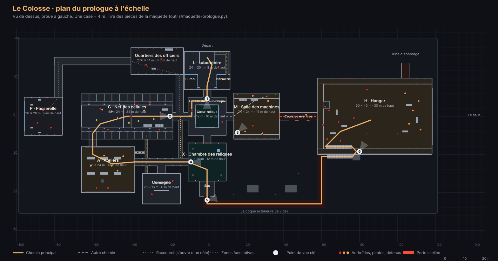
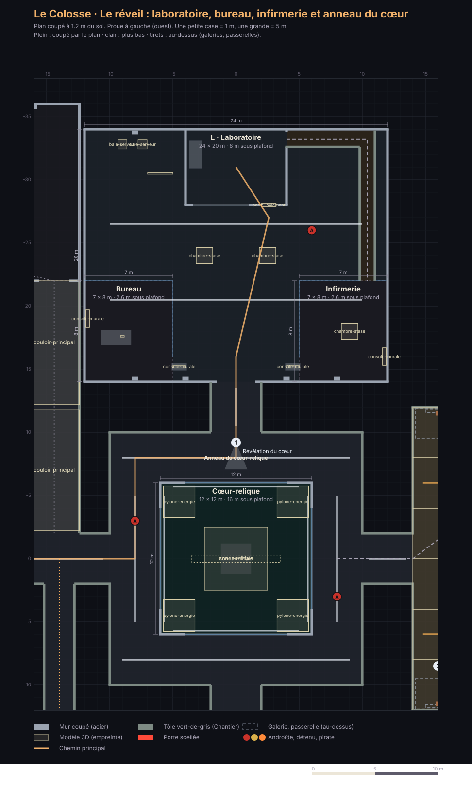
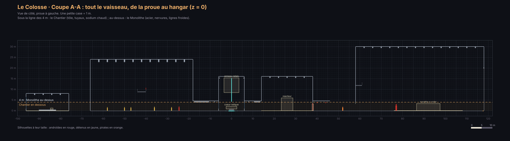

# Plan du niveau du prologue : l'évasion du Colosse

> Écrit d'après [`docs/PROMPT-DA-ET-PLAN.md`](../PROMPT-DA-ET-PLAN.md), avec la direction artistique de la [bible](BIBLE-DA.md).
> **Où on en est** : le schéma des zones a été validé le 29 octobre 2026. Le plan à l'échelle, les mesures, les points de vue, les verrous et les modèles sont faits ; la maquette de l'atelier est construite d'après ce plan.

## Les intentions et les contraintes

- **La durée** : 30 à 45 minutes la première fois. La cible est de 41 minutes.
- **Les étapes** : 6, celles de [`PREPRODUCTION.md`](../PREPRODUCTION.md) :
  1. le réveil ;
  2. les cellules s'ouvrent ;
  3. l'équipement ;
  4. le vide ;
  5. le hangar ;
  6. l'hyperespace.
- **Plusieurs chemins** : chaque étape se réussit d'au moins deux façons, et on ne bloque jamais le joueur.
- **Les zones facultatives** donnent des indices sur l'identité du héros. Le joueur curieux en apprend plus que celui qui fonce.
- **Trois camps** (les androïdes de la sécurité, les pirates, les détenus) se battent aussi entre eux. Le joueur peut s'en servir.
- **Les mesures** sont celles de la bible : coursives de 4 m, nef des cellules de 24 m de haut, hangar de 30 m de haut.

## 1. Le rythme

| # | Séquence | Étape | Durée | Tension | Ce qu'on fait | Ce qu'on ressent | Ce qu'on apprend |
|---|---|---|---|---|---|---|---|
| 1 | Le réveil | 1 | 3 min | 1,5 | Regarder, marcher dans la cellule d'observation ; un souvenir flou | Confusion | Regarder, se déplacer |
| 2 | La panne | 1 | 1 min | 3 | Secousses de l'abordage, la lumière saute, la porte s'ouvre | Choc | — |
| 3 | Sortir du laboratoire | 1 | 4 min | 2 | Fouiller ; facultatif : le bureau de la Conservatrice, l'infirmerie | Curiosité | Interagir, fouiller |
| 4 | La nef des cellules | 2 | 6 min | 4 | La ruée des détenus, les androïdes qui tirent : se cacher, faire peu de bruit, trouver une arme de fortune | Panique | S'accroupir, se cacher, le bruit, ramasser |
| 5 | Ateliers, consigne, conduits | 3 | 7 min | 3 | Ouvrir la chambre des reliques : rétablir le courant, pirater la porte ou trouver le badge | Tension | Les chemins multiples, le piratage |
| 6 | La chambre des reliques | 3 | 3 min | 1 | La combinaison, la capsule, les glyphes qu'il lit | Émerveillement | (l'histoire) |
| 7 | Le sas et la coque | 4 | 6 min | 3 | Bottes magnétiques, oxygène limité, silence | Vertige | Le vide, l'air, le bruit qui change |
| 8 | L'entrée du hangar | 5 | 2 min | 2 | Observer d'en haut, choisir comment passer | Anticipation | Lire une situation |
| 9 | Le hangar | 5 | 6 min | 5 | Androïdes contre pirates ; ouvrir le sas sur le vide pour aspirer les ennemis | Pression | Se servir du décor |
| 10 | Démarrer la navette | 5 | 2 min | 4 | Démarrer et fuir sous le feu des tourelles | Urgence | — |
| 11 | Le saut | 6 | 1 min | 1 | L'hyperespace ; il cache le chargement | Délivrance | — |

**Les règles du rythme** :
- **Jamais deux pics de suite sans un creux.** La chambre des reliques et l'entrée du hangar sont des respirations voulues.
- **La tension 5 n'arrive qu'une fois**, au hangar : c'est le sommet du prologue.
- **Chaque nouvelle règle de jeu s'apprend dans un moment calme**, avant d'être mise sous pression :
  - se cacher, avant la nef ;
  - le vide, avant le hangar.

## 2. Le schéma des zones

**Le chemin principal** :
cellule d'observation → laboratoire → anneau du cœur-relique → nef des cellules → ateliers → chambre des reliques → sas → coque extérieure → hangar → navette.

**Au moins deux façons de réussir chaque étape** :

| Étape | Première façon | Deuxième façon | Troisième façon |
|---|---|---|---|
| 1. Sortir du laboratoire | La porte, ouverte par la panne | Le conduit d'aération de la cellule d'observation | — |
| 2. Traverser la nef des cellules | Le pont central, au milieu des combats | Les coursives des niveaux, en se cachant | Les conduits sous la nef |
| 3. Ouvrir la chambre des reliques | Rétablir le courant dans la salle des machines (combat ou sabotage) | Pirater la porte depuis la console de la consigne | Le badge de la Conservatrice, dans les quartiers des officiers |
| 4. Rejoindre le hangar | La coque extérieure, par le sas | La coursive éventrée, ouverte sur le vide | La passerelle, qui ouvre le hangar par le haut (facultatif) |
| 5. Prendre la navette | Combattre | Ouvrir le sas du hangar sur le vide : les ennemis sont aspirés | Passer par les passerelles hautes pendant qu'androïdes et pirates s'affrontent |
| 6. Le saut | Une scène jouée | — | — |

**Les verrous et ce qui les ouvre** :
- **La chambre des reliques** : sa porte n'a plus de courant. On l'ouvre avec le courant, le piratage ou le badge.
- **Le vide** (le sas, la coque, la coursive éventrée) demande la combinaison. Les reliques passent donc forcément avant le vide, ce qui garde l'ordre de l'histoire.
- **Le hangar** : sa grande porte est tenue par les androïdes, dont un androïde lourd et un marcheur blindé. On y entre par le sas de la coque, par le bas (la coursive éventrée) ou par le haut (la passerelle).

**Jamais coincé** :
- Chaque verrou a au moins deux clés.
- Si une console est détruite pendant un combat, une autre clé reste possible.
- Les conduits relient toujours la nef, les ateliers et la consigne.

**Les zones facultatives et leurs indices** :

| Zone | Ce qu'on y trouve |
|---|---|
| Bureau de la Conservatrice | Son dossier sur le « sujet V-0 » |
| Infirmerie | Le scanner médical : un sang chargé d'Éther, un rythme cardiaque impossible |
| Quartiers des officiers | L'armurerie (une meilleure arme) et le badge de la Conservatrice |
| Consigne | Un objet saisi couvert de glyphes, que le héros lit sans effort |
| Nef des cellules | Des détenus à libérer, qui deviennent des alliés de fortune |
| Passerelle | La vue sur la planète, et l'ouverture du hangar par le haut |

**Les camps, zone par zone** :

| Camp | Zones |
|---|---|
| Androïdes et drones (la sécurité n'emploie aucun humain) | Laboratoire, anneau, nef, consigne, quartiers des officiers, passerelle, hangar ; drones au-dessus de la nef, des machines et du hangar |
| Pirates | Salle des machines, coursive éventrée, hangar |
| Détenus | Nef des cellules, ateliers |

**Ce qui change par rapport à la maquette actuelle** :
- Deux nouvelles zones : l'infirmerie et la troisième clé des reliques (le badge).
- Les zones gardent leur rôle, mais elles seront redessinées à l'échelle de la bible. La nef des cellules et le hangar deviennent les deux grands volumes.

## 3. Le plan à l'échelle

Le plan est tiré des pièces mêmes de la maquette : `python3 outils/maquette-prologue.py` reconstruit les deux à la fois, ils ne peuvent pas diverger.

- **Le repère** : mètres. X va de la proue (ouest) vers la poupe (est), Z vers le sud, Y vers le haut. L'origine est le cœur-relique.
- **L'emprise du vaisseau** : 214 m sur 84 m pour la partie jouable. Le pont est en Y = 0.

| Zone | Emprise (x ; z) | Taille | Hauteur | Entrées et sorties | Abris, cachettes | Camps | Repère visible de loin | La lumière qui guide |
|---|---|---|---|---|---|---|---|---|
| **Cellule d'observation** (départ) | −4 à 4 ; −34 à −28 | 8 × 6 m | 4 m | Porte vers le laboratoire ; conduit d'aération à l'est | — | — | La vitre sur le laboratoire | La lampe froide de la cellule |
| **Laboratoire** | −12 à 12 ; −34 à −14 | 24 × 20 m | 8 m | La cellule ; une grande porte au sud, vers l'anneau | Chambres d'étude, baies de serveurs | 1 androïde médical | Les chambres d'étude | Deux lignes froides ; après la panne, les gyrophares |
| Bureau de la Conservatrice (facultatif) | −12 à −5 ; −22 à −14 | 7 × 8 m | vitré, 2,6 m | Porte vitrée à l'est | Sous le bureau | — | Le dossier | — |
| Infirmerie (facultative) | 5 à 12 ; −22 à −14 | 7 × 8 m | vitrée, 2,6 m | Porte vitrée à l'ouest ; arrivée du conduit | — | — | Le scanner | — |
| **Anneau du cœur-relique** | carré de 20 m | coursive de 4 m | 4,5 m | Laboratoire (nord), nef (ouest), machines (est), reliques (sud, porte scellée) | Les angles | 2 androïdes en ronde | **Le cœur cyan, par les hublots** | Lignes froides |
| Puits du cœur | −6 à 6 ; −6 à 6 | 12 × 12 m | 16 m | Hublots de 8 m, pas de porte | — | — | Le cœur | Le cyan, la seule couleur froide vivante |
| **Nef des cellules** | −66 à −18 ; −12 à 12 | 48 × 24 m | 24 m, 5 niveaux de 4,5 m | Entrée à l'est ; sortie par une cellule au sud-ouest ; trou d'un conduit dans une cellule ; escaliers jusqu'au niveau 3 | Cellules ouvertes du rez-de-chaussée, piliers, dessous des escaliers | Gardes sur les coursives des niveaux 2 à 4 et au poste d'entrée ; détenus au fond | Le pont transversal du niveau 3 | Deux lignes froides à 22 m ; gyrophares aux deux bouts ; une lampe chaude par cellule |
| **Ateliers** | −66 à −38 ; 16 à 40 | 28 × 24 m | 10 m | La nef (nord), la coursive sud (est), un conduit (est) | Établis, caisses | Détenus, alliés possibles | Le pont roulant à 8 m | Îlots au sodium sur les postes |
| Coursive sud | −38 à −10 ; 22 à 26 | 28 × 4 m | 4,5 m | Ateliers, consigne, raccourci, reliques | Les nervures | — | La porte scellée rouge, au bout | Lignes froides ; croisements chauds |
| **Consigne** | −34 à −14 ; 30 à 46 | 20 × 16 m | 6 m | Coursive sud ; un conduit | Rayonnages, armoires | 2 androïdes | La chambre forte, en ambre | Les casiers qu'on peut ouvrir, en ambre |
| **Chambre des reliques** | −10 à 10 ; 14 à 34 | 20 × 20 m | 12 m | Deux portes scellées (ouest, nord) ; le sas au sud | Les stèles | — | La capsule et les lignes cyan | Le cyan ; une seule ligne froide, très haut |
| Sas | −4 à 4 ; 34 à 42 | 8 × 8 m | 4,5 m | Les reliques ; la coque | — | — | — | Sodium |
| **Coque extérieure** | un chemin de 4 m de large | environ 110 m | le vide | Le sas ; une montée de 12 m le long du hangar | Antennes, bouches d'aération | — | Le hangar et ses balises | Balises rouges le long du chemin |
| **Salle des machines** | 14 à 38 ; −12 à 12 | 24 × 24 m | 16 m, passerelles à 4 et 8 m | L'anneau (ouest) ; la coursive éventrée (est, il faut la combinaison) | Générateurs, pylônes, dessous des passerelles | 3 pirates | Le réacteur | Sodium ; passerelle bordée d'ambre |
| Coursive éventrée | 38 à 58 ; −2 à 2 | 20 × 4 m | ouverte sur le vide | Les machines ; le hangar, au sol | Débris | 1 pirate en combinaison | Le vide, au sud | Gyrophares |
| **Hangar** | 58 à 118 ; −20 à 20 | 60 × 40 m | 30 m, galeries à 12 m | Sas de la galerie sud (depuis la coque) ; coursive éventrée (sol) ; porte des gardes (nord, scellée) ; tube d'abordage (nord) ; sas sur le vide (est) | Abris, caisses, navette de transfert | Gardes à l'ouest, pirates à l'est | La navette sous les projecteurs | Projecteurs froids sur la navette |
| Quartiers des officiers (facultatifs) | −40 à −12,4 ; −36 à −22 | 27,6 × 14 m | 4,5 m | Coursive nord-ouest ; coursive vers la passerelle | Lits | 2 androïdes | L'armurerie, en ambre | Sodium sur le badge |
| Passerelle (facultative) | −96 à −76 ; −10 à 10 | 20 × 20 m | 8 m | Une coursive au nord | Pupitres | 3 droïdes de sécurité | La baie vitrée sur l'espace | Écrans ambre |

## 4. Les mesures

**Le joueur**

| Mesure | Valeur |
|---|---|
| Taille | 1,80 m, les yeux à 1,70 m |
| Marche | 1,6 m/s |
| Course | 4,5 m/s |
| Accroupi | 0,9 m/s ; 1,2 m de haut |
| Sur la coque (bottes magnétiques) | 1,0 m/s |
| Enjamber | jusqu'à 0,6 m |
| Se hisser | jusqu'à 1,2 m |
| Échelles | partout où un niveau monte de plus de 4 m |

**Les passages**

| Passage | Mesure |
|---|---|
| Porte ordinaire | 1,6 × 2,6 m |
| Grande porte | 3 × 3,2 m |
| Sas | 3 × 3 m |
| Porte de la nef ou du hangar | 8 × 10 m |
| Coursive principale | 4 × 4,5 m |
| Coursive de service | 2,4 × 3 m |
| Conduit | 1,2 × 1,2 m dans le jeu ; 2 m de haut dans la maquette, pour la visite |
| Garde-corps | 1,1 m |
| Abri bas | 1,2 m : on s'y cache accroupi |
| Abri haut | 2 m |
| Marches | 18 × 28 cm dans le jeu ; 25 × 30 cm dans la maquette, pour garder peu de pièces |

**Les ennemis** (première version, à régler en jouant)

| Camp | Vue, en lumière | Vue, dans le noir | Champ de vision | Entendent les pas | Entendent la course | Entendent un tir |
|---|---|---|---|---|---|---|
| Androïdes | 25 m | 10 m | 90° | 6 m | 15 m | 40 m |
| Pirates | 20 m | 8 m | 110° | 6 m | 15 m | 40 m |
| Détenus hostiles | 12 m | 6 m | 120° | 4 m | 10 m | 30 m |

**Dans le vide**, on n'entend rien : seulement les chocs qui passent par la coque, à 5 m.

## 5. Les points de vue clés

| # | Nom | Position (x ; y ; z) | Regarde vers | Ce qu'on voit | Ce que ça dit |
|---|---|---|---|---|---|
| 1 | La révélation du cœur | 0 ; 1,7 ; −9,2 | le sud, le puits | Par le hublot de 8 m, le cœur cyan dans son puits de 16 m | Le seul cyan avant les reliques : la couleur du héros |
| 2 | La première vue de la nef | −19,5 ; 1,7 ; 0 | l'ouest | 48 m de cellules sur 5 niveaux, le pont, les lignes froides à 22 m | L'Empire écrase |
| 3 | Les machines | 16 ; 1,7 ; 8,5 | le réacteur | Le réacteur, les passerelles, la console tout en haut | Le Chantier, et le but placé en hauteur |
| 4 | La chambre des reliques | −8,5 ; 1,7 ; 24 | l'est | Le noir, des lignes cyan qui mènent à la capsule | Le calme ; il est chez lui |
| 5 | La sortie sur la coque | 0 ; 1,7 ; 44 | le hangar, au loin | Le chemin balisé de rouge, le hangar éclairé | Le vertige, le but visible |
| 6 | Le hangar d'en haut | 80 ; 13,7 ; 18,5 | la navette, vers le bas | La navette sous les projecteurs, les androïdes à l'ouest, les pirates à l'est | Observer, puis choisir |

Les rendus de ces vues, dans l'atelier, sont dans la bible, au § 16.

## 6. Les boucles et les verrous

| Verrou | Ce qui l'ouvre | Le secours |
|---|---|---|
| La cellule d'observation | La panne (une scène) | Le conduit d'aération, vers l'infirmerie |
| Les portes scellées des reliques (ouest et nord) | Le courant (la console de la salle des machines, à 8 m), **ou** le piratage (la console de la consigne), **ou** le badge (les quartiers des officiers) | Trois clés ; il en suffit d'une |
| Le raccourci de service | Il ne s'ouvre que depuis la coursive sud | Une fois aux ateliers, on revient vite à l'anneau et aux machines |
| La cloison des machines vers la coursive éventrée | La combinaison : la cloison la reconnaît | Le sas des reliques |
| Le sas des reliques vers la coque | La combinaison | La coursive éventrée |
| La porte des gardes du hangar | La commande de la passerelle (facultative) | Les deux autres entrées du hangar |
| Le sas du hangar sur le vide | La console du poste de contrôle, sur la galerie ouest : elle aspire les ennemis | Le combat, ou les galeries pendant que les camps s'affrontent |

**Les boucles** :
- **La boucle de l'anneau** : nef, anneau, machines.
- **La boucle du sud** : ateliers, coursive sud, raccourci, anneau.
- **La boucle des conduits** : nef, coursive sud, ateliers, consigne.
- **Après les reliques, deux routes vers le hangar** : par la coque, on arrive en haut, sur la galerie ; par la coursive éventrée, on arrive en bas, au sol.

**Jamais coincé** :
- Chaque verrou a au moins deux clés.
- Les conduits relient toujours la nef, les ateliers et la consigne.
- Si une console est détruite pendant un combat, une autre clé reste possible.

## 7. Les plans détaillés et les coupes

Tirés des mêmes pièces que la maquette par `outils/plans_colosse.py` (appelé par `outils/maquette-prologue.py`) : refaire la maquette refait les plans.

**Les plans par secteur** sont coupés à 1,20 m du sol, comme un plan d'architecte :
- ce que le plan de coupe traverse est plein ;
- ce qui est plus bas est clair ;
- les galeries et les passerelles du dessus sont en tirets, avec leur hauteur.

On y trouve aussi :
- l'empreinte de chaque modèle à sa taille réelle ;
- les cotes des salles ;
- les personnages (A androïde, D détenu, P pirate), avec leur hauteur s'ils sont en étage ;
- les chemins et les points de vue.

| Plan | Ce qu'il montre |
|---|---|
| [Le réveil](plans/plan-01-reveil.svg) | Laboratoire, cellule d'observation, bureau, infirmerie, anneau et puits du cœur |
| [La nef](plans/plan-02-nef.svg) | La nef des cellules, ses galeries, les ateliers et la consigne |
| [Les reliques](plans/plan-03-reliques.svg) | La chambre des reliques, le sas, la sortie sur la coque |
| [Les machines](plans/plan-04-machines.svg) | La salle des machines, ses passerelles, la coursive éventrée |
| [Le hangar](plans/plan-05-hangar.svg) | Le hangar, ses galeries à 12 m, l'escalier de la coque, le tube d'abordage |
| [Le facultatif](plans/plan-06-facultatif.svg) | Les quartiers des officiers et la passerelle |

**Les coupes** montrent les hauteurs, les niveaux, les personnages à leur taille et la ligne des 4 m entre le Chantier et le Monolithe :

| Coupe | Où |
|---|---|
| [A-A](plans/coupe-A-longitudinale.svg) | Tout le vaisseau, de la passerelle au hangar (z = 0) |
| [B-B](plans/coupe-B-nef.svg) | La nef en travers : ses cinq niveaux de 4,5 m |
| [C-C](plans/coupe-C-hangar.svg) | Le hangar en travers : la navette, les galeries |
| [D-D](plans/coupe-D-reliques.svg) | Du laboratoire au sas, par le cœur et les reliques (x = 0) |

## 8. Quel modèle va où

<!--MODELES-DEBUT-->
| Zone | Modèles |
|---|---|
| L · Laboratoire | `androide-medical`, `baie-serveur` × 2, `cables`, `chambre-stase` × 2, `console-murale` × 2, `porte-isolement` |
| Bureau | `console-murale`, `tablette-glyphes` |
| Infirmerie | `chambre-stase`, `console-murale` |
| Dehors : la coque et l'espace | `androide-antiemeute`, `androide-sentinelle`, `debris-1` × 2, `debris-2`, `rocher-spatial`, `vaisseau-pirate` |
| Cœur-relique | `anneau-relais`, `coeur-relique`, `pylone-energie` × 4 |
| C · Nef des cellules | `androide-antiemeute`, `androide-patrouille` × 2, `androide-sentinelle`, `cle-a-molette`, `console-murale`, `detenu-brute` × 2, `detenu-figurant` × 3, `detenu-tshirt` × 3, `droide-securite`, `drone-securite` × 2, `lavabo`, `lit-superpose` × 4, `toilettes` × 4 |
| Coursives | `couloir-principal` × 7 |
| Quartiers des officiers | `androide-antiemeute`, `androide-sentinelle`, `caisse-armes`, `fusil-gardes`, `lit-superpose` × 2, `pistolet-gardes` |
| P · Passerelle | `console-murale` × 5, `droide-securite` × 3 |
| A · Ateliers | `androide-soldat`, `androide-vieux-modele`, `caisse-armes`, `caisses` × 3, `cellule-energie` × 2, `detenu-brute`, `detenu-figurant` × 2, `detenu-tshirt` × 2 |
| Consigne | `androide-patrouille`, `androide-sentinelle`, `armoire-blindee` × 2, `casier` × 9, `console-murale`, `porte-coffre`, `tablette-glyphes` |
| X · Chambre des reliques | `armoire-blindee`, `capsule-veilleur`, `cloison-etanche` × 2, `combinaison-veilleur`, `cristal-ether`, `prisme-ether`, `tablette-glyphes` |
| Sas | `porte-sas` × 2 |
| H · Hangar | `androide-antiemeute` × 2, `androide-lourd`, `androide-patrouille` × 2, `androide-sentinelle`, `bidon-carburant` × 2, `caisse-armes`, `caisses` × 2, `capsule-sauvetage` × 2, `cellule-energie` × 2, `console-murale`, `drone-securite`, `marcheur-blinde`, `navette-a-voler`, `navette-transfert`, `pirate-chef`, `porte-sas` |
| M · Salle des machines | `coeur-fusion`, `console-murale`, `drone-securite`, `generateur` × 2, `pirate`, `pylone-energie` × 2, `reacteur` |
| Coursive éventrée | `cables`, `cloison-etanche`, `pirate-eva` |

Et 69 dalles de sol (`sols`), dans la passerelle, la salle des machines et l'aire d'envol du hangar. Chaque modèle est posé à sa taille réelle (`tailles-modeles.json`) ; le bouton Contrôle de l'atelier vérifie qu'aucun ne chevauche un mur.
<!--MODELES-FIN-->
